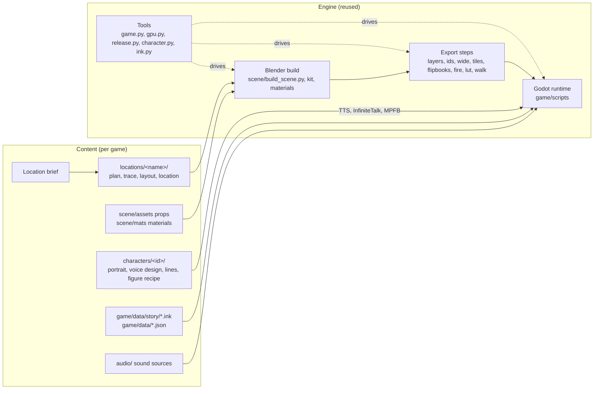

# The engine: a template for pre-rendered RPGs

This repository holds two things: an engine for pre-rendered, voiced, Disco Elysium-style
games, and the garrison content built on it. This file separates the two, lists every feature
the engine supports and how it is built, and describes how to start a new game from it. The
learnings are in [POSTMORTEM.md](POSTMORTEM.md).

## The pipeline

## Engine and content, file by file

### Engine: keep these

| Area | Files |
|------|-------|
| Blender build | `scene/build_scene.py`, `kit.py`, `planlib.py`, `location.py`, `materials.py`, `mats/_scan.py`, `game_room.py`, `terrain.py` (still courtyard-specific; generalise it) |
| Export | `scene/export_game.py`, `game_frame.py`, `game_layers.py`, `game_views.py`, `game_walk.py`, `game_fire.py`, `game_flipbooks.py`, `bake_view_lut.py`, `anim.py`, `anim_crows.py` |
| Generic props | `scene/assets/__init__.py`, `_fire.py`, `_lights.py`, `_tube.py`, `_sweep.py`, `human.py`, `crow.py`, `crow_flying.py`, `ground_mist.py`, `drips.py`, `grass_tuft.py`, `debris.py` |
| Godot runtime | everything in `game/scripts/` and `game/shaders/`, `game/addons/inkgd` |
| Tools | `scripts/game.py`, `gpu.py`, `release.py`, `ink.py`, `character.py`, `design_voice.py`, `make_character.py`, `walkcheck.py`, `fetch_textures.py`, `fetch_character_assets.py`, `compare.py` |
| Process | `.claude/skills/` except `story-bible`, and `AGENTS.md` without its game sections |

### Content: replace these

`locations/*`, the garrison props in `scene/assets/` (gallows, forge, kitchen, tower, ditch,
shed and others), `characters/*`, `game/data/*` (story, npcs, items, journal, chapters,
skills, archetypes, sounds), `audio/`, `ref/`, `.claude/skills/story-bible`, and the game
sections of `AGENTS.md`.

## Features and how each is built

### The picture

| Feature | How |
|---------|-----|
| Photoreal pre-rendered set | Blender builds the location from `plan.json` with procedural props and Poly Haven scan materials. Cycles renders it once, offline. |
| Fixed orthographic camera per location | `trace.json`: elevation, yaw, metres per frame. Rooms use a steeper, squarer camera. |
| Live light | The frame is split into light groups. Godot draws `base + Σ group × intensity`, with flicker curves ported from Blender (`curves.gd`, `anim.py`). |
| Characters behind walls | The export writes a depth pass. Live figures, crows and rain are depth-tested against it. |
| Zoom | A wide frame for zoom 0.5, the main frame at 1, and tiles at 2× per hotspot, streamed one layer per frame. |
| Colour grading | AgX "Punchy" baked to a 3D LUT, plus the still's post: saturation, bloom, lift/gamma/gain, vignette. |
| Weather | GPU rain particles with wind, gusts and depth-tested splashes. Wet surfaces come from the render. |
| Animated elements | Flipbooks for smoke, fire and banners, rendered at their depth. Crows are live 3D with perch, idle and take-off. |
| Interiors | A location with `"kind": "room"`: cutaway walls, an invisible ceiling, point lights only, no rain, a room tone. |

### People

| Feature | How |
|---------|-----|
| 3D figure | MPFB human plus CMU motion capture (`make_character.py`, `characters/<id>/recipe.json`). AnimationTree blends idle, walk and talk; the walk follows ground speed. |
| Figure look | `figure.gdshader`: matte wool, skin wrap, sky rim, white balance against fire light, lamp knee, baked occlusion, a floor shadow from three lamps. |
| Talking portrait | A gpt-image portrait framed on the face. InfiniteTalk on RunPod turns each line into a clip, shown as frames in the dialogue column, with a listening loop between lines. |
| Voice | Designed from a text description (Qwen3-TTS VoiceDesign) or cloned. A 15–18 s reference voices every line through `tools/say`. |
| One command per person | `scripts/character.py <id> voice pick clips game` renders, picks, makes clips and writes the game data from `character.json`. |

### Play

| Feature | How |
|---------|-----|
| Click to walk | Navmesh baked from the exported walk mesh plus stair links. Footsteps by surface. |
| Hotspots | An id mask from the render. Hover glows and Tab outlines everything. Look texts come from Ink knots `look_<id>`. |
| Doors and locations | Portals within a location; exits to other locations with a fade and an autosave. |
| Dialogue | Ink through inkgd. Tags for speaker, voice line, skill line, check and journal; externals for items, flags, rolls and chapter end. |
| Skills and checks | Six skills from JSON. Passive checks speak as inner voices. White checks can be retried; red checks are one try only. Dice are seeded by game seed, check and attempt, so a loaded save never rerolls. |
| Character creation | Archetypes or a custom spread of points. |
| Journal, inventory, character sheet | `journal.gd`, `inventory.gd`, `sheet_ui.gd`, fed by Ink tags and externals. |
| Chapters | `end_chapter("<id>")`: a card, then a page of the player's choices and rolls. |
| Saves | Slots, quick save, autosave on location change. Ink state, skills, rolls and journal. |
| Menus and settings | Title, pause, load and save, settings for volumes, text speed, auto-advance and fullscreen. |
| Controller | Xbox pad through InputMap actions: stick walks, D-pad selects the nearest interactable, A/B/X/Y and shoulders. |
| Audio | Ambience bus with a zoom low-pass, a fire loop at the hearth, voices duck the ambience, no reverb. |

### Tooling

| Feature | How |
|---------|-----|
| Render tiers | `game.py check` (no GPU), `preview` (EEVEE), `draft` (low samples), `final` (Cycles). Only stale steps re-run, by content hash. |
| GPU queue | `gpu.py run` serialises every GPU job and logs timings. |
| Automatic checks | Smoke test, systems test on a fixture story, a scripted playthrough, menu/UI/character screenshot runs, walkability check without rendering. |
| Release | `release.py`: ASTC HDR compressed textures, one `.pck`, a Mac app, and a check that runs inside the exported app. |

## Features a Disco Elysium-scale game still needs

The engine does not have these yet.

**Rendering and camera**
- A fixed internal render resolution with upscaling, so 5K screens run at 60 fps.
- A camera that pans across a frame larger than the screen, with edge regions.
- Figure shadows from the skinned mesh, blocked by proxy geometry.
- A screen-space outline for live figures and items.
- Time of day and weather states as alternative light-group sets of one render.
- Visual regression: golden screenshots per location with a diff threshold.

**Characters**
- NPCs that walk routes and schedules, change position with story state, and say ambient barks.
- Story-driven world changes: props and hotspots that appear or vanish by Ink variable.
- A local talking-head model, so lines can be re-voiced without a cloud cost per clip.
- Better figures: a retarget with a corrected rest pose, cloth, and hand scale checks.

**Role-playing systems**
- A thought cabinet: thoughts found in dialogue, researched over time, with effects on skills.
- Health and morale as two damage tracks, with consumables.
- Experience, skill points on level-up, and retrying a white check after a skill rises.
- Clothing and items that change skill values.
- A clock: time passes with actions, and events and people depend on it.
- A map of discovered locations, with travel between them.
- A full dialogue log to scroll back.
- More voices per skill, including a location voice (like Shivers) triggered by place.

**Production**
- Localisation: every line keyed, text tables per language.
- Accessibility: text size, contrast, subtitles for every voice and sound cue.
- Music: a system for stems and stingers (there is no music model in the workflow).
- A dialogue editor view or a graph export of the Ink story for review.
- A bug log and a QA checklist run every round.

## Starting a new game from this template

1. **Copy the engine.** Make a new repository with the engine files from the table above.
   Delete the content, keep one small test location and one test character so every check
   still runs.
2. **Write the briefs before any build.**
   - A world and story outline (the new `story-bible` skill).
   - Art direction: time, weather, palette, references, and the consistency rules.
   - One brief per location: function of every building or room, the camera, the walk routes,
     the exits, what must be readable at the main camera.
   - One brief per character: role, look, voice description.
3. **Set the targets.** The target machine and screen, frame rate, and quality bar for each area
   (look, motion, sound).
4. **Build in rounds.**
   - The coordinator splits work by file ownership and briefs fresh agents with the skills.
   - A QA agent runs the checklist at the target resolution and files bugs.
   - You approve art direction, character art and audio.
5. **Point Claude at it with references.** A reference image for a location or a character, plus
   its brief, is enough input. The pipeline turns it into a location or a speaking person.

## Splitting the skills for reuse

| Skill | Reuse |
|-------|-------|
| `agent-workflow` | As is. Add the QA agent, the bug log and the acceptance checklist. |
| `scene-build` | Keep the generic parts: locations, rooms, props, materials, look. Move the courtyard facts to the game's own notes. |
| `game-export` | As is. |
| `godot-runtime` | As is. |
| `npc-pipeline` | As is. |
| `sound-effects` | Rewrite: library first, generation for gaps, you pick on a contact sheet. |
| `story-bible` | New per game. |
| New: `location-brief` | How to write and approve a location brief before building. |
| New: `qa-pass` | The acceptance checklist, golden screenshots, performance at the target screen, bug filing. |
